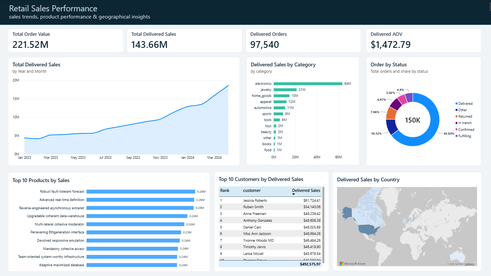
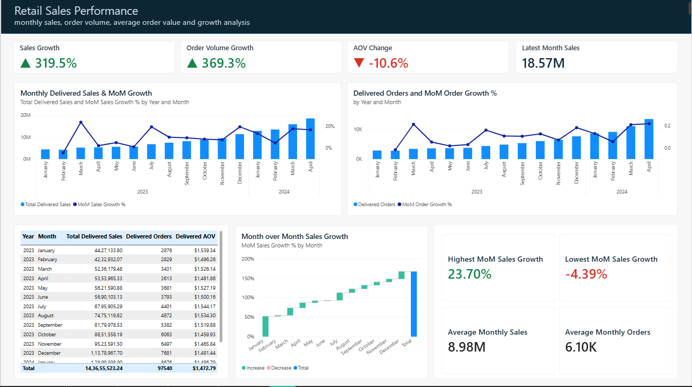
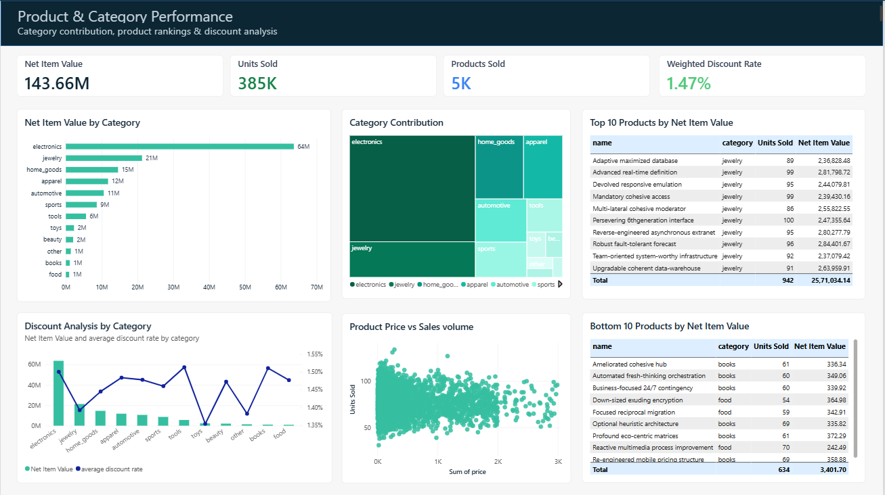
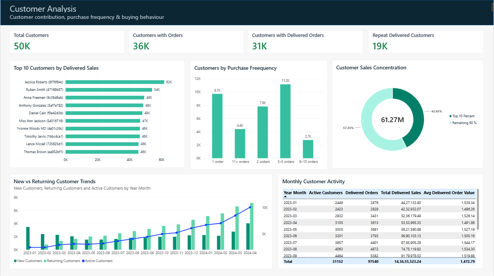

# Retail Sales Performance Analysis

An interactive four-page Power BI portfolio project exploring retail sales performance, monthly trends, product categories, and customer patterns using a synthetic retail dataset.

## Live Dashboard

**[Open the interactive Power BI report](https://app.powerbi.com/view?r=eyJrIjoiMGUyMTkxMTUtNWE4MS00ZDIzLWI2ZTMtYjM5ZWMxMTdkZjI3IiwidCI6IjgyMGFjZTNjLTRhYzMtNDUzNS1hZTU2LTI2M2VlODY2Y2M3NiJ9)**

The report is published publicly for portfolio demonstration. Do not use this public report setup for confidential data.

## Dashboard Preview

### 1. Retail Sales Performance

### 2. Monthly Sales Performance

### 3. Product Category Performance

### 4. Customer Analysis

## Project Overview

This project brings retail data into a multi-page Power BI report supported by SQL data exploration. The goal is to present business-oriented views of performance through interactive visualizations and clear reporting.

## Questions Explored

- How do sales change over time?
- Which products and categories stand out in performance?
- What patterns are visible in customer analysis?
- What can order and return data reveal about retail operations?

## Tools and Technologies

- **Power BI** — report building and interactive visual analytics
- **SQL** — data profiling and analytical queries
- **CSV / SQLite** — data files used in the analysis

## Repository Structure

- `reports/` — Power BI report file
- `sql/` — SQL scripts for profiling and analysis
- `processed/` — processed retail data in CSV format
- `raw/` — source SQLite database
- `docs/` — data profiling and project documentation
- `screenshots/` — dashboard page previews

## How to Explore

1. Open the [live dashboard](https://app.powerbi.com/view?r=eyJrIjoiMGUyMTkxMTUtNWE4MS00ZDIzLWI2ZTMtYjM5ZWMxMTdkZjI3IiwidCI6IjgyMGFjZTNjLTRhYzMtNDUzNS1hZTU2LTI2M2VlODY2Y2M3NiJ9) to interact with the report.
2. Browse the screenshots above for a quick visual overview.
3. Explore the SQL scripts and profiling documentation to review the analysis workflow.

## Data Note

This is a portfolio project based on synthetic retail data. Public Power BI links can expose report content and underlying data to anyone who has access to the link, so only share data that is safe to make public.
